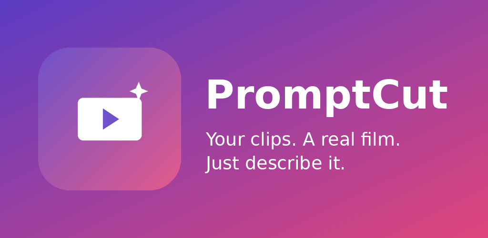

<p align="center">
  
</p>

<h1 align="center">PromptCut</h1>

<p align="center"><b>Edit videos on Android by typing what you want.</b><br>
AI plans the cut, your phone renders it: no cloud rendering, no watermark, no subscription.</p>

<p align="center">
  
  
  
  
</p>

<p align="center"></p>

## What it does
Pick your clips, type something like *"make a 30-second reel of the best moments"*, and PromptCut:

1. **Understands the footage on the phone**: shot changes, faces and smiles, objects, blurry/dark/shaky parts,
   loud moments and speech.
2. **Asks a free AI model** (Google Gemini or Groq, using your own free key) for an *edit plan*: which parts to
   use, in what order, at what speed, in which format.
3. **Renders the video on the device** with Media3 Transformer and the phone's hardware encoder.
4. **Checks its own output** (orientation, length, sound, music, colours, dull shots), fixes what it can, and
   shows you a checklist.

Then refine by chatting: *"shorter intro"*, *"make it 16:9"*, *"add music"*, *"no title"*.

### Highlights
- **Film-maker editing rules**: story structure (opening, build, highlight, ending), scene mixing, shot length by
  mood, no cuts mid-sentence, cuts snapped to shot changes and the music beat.
- **Music**: royalty-free mood music composed on the phone, free Creative Commons songs (Openverse), or your own
  song with BPM detection, auto-ducking under speech and fades.
- **Formats & looks**: 9:16, 16:9, 1:1 with face-aware reframing; transitions (fade, Ken Burns, dip to black,
  flash, zoom punch); colour looks.
- **Long videos**: hours of footage via chunked analysis and two-step planning; outputs up to 10 minutes.
- **Reliable**: background foreground-service rendering, automatic safe mode (shot-by-shot render), free-tier
  retries and model fallback.
- **Private**: API keys are encrypted with the Android Keystore and stay on the phone. See the
  [privacy policy](docs/privacy-policy.html).

## How it works
1. **Clips** are read on-device (duration, resolution, audio) and a few small frames are sampled (Gemini only).
2. **Planning**: the clip list, frames and your request go to the AI, which returns a JSON *edit plan*
   (segments with clip/start/end/speed, aspect, title, mute). The app validates and repairs it; if it's unusable,
   the app asks the model once to fix it.
3. **Rendering**: Media3 Transformer trims, re-orders, changes speed, crops to 9:16 / 16:9 / 1:1 and adds a title,
   using the phone's hardware encoder. Output can be saved to `Movies/PromptCut` or shared.

## Free AI keys (users bring their own)
The first screen walks the user through getting a free key and links straight to the page:
- **Google Gemini** — https://aistudio.google.com/apikey (recommended; sees the frames)
- **Groq** — https://console.groq.com/keys (fast open models; text-only)

"Check & save key" calls the provider's model list, verifies the key and auto-picks a current model,
so the app keeps working when providers rename models. Keys are stored only on the phone.

## Build & run
Requirements: Android Studio (or the command line with JDK 17), Android SDK 36. The app runs on Android 10+
(minSdk 29).

```bash
./gradlew assembleDebug        # debug APK in app/build/outputs/apk/debug/
./gradlew testDebugUnitTest    # unit tests (plan parsing, film rules, mixer, QA metrics, ...)
./gradlew bundleRelease        # shrunk, signed release bundle for Google Play
```

**Release signing**: create a `keystore.properties` in the project root (it is git-ignored):

```properties
storeFile=/path/to/upload.jks
storePassword=...
keyAlias=...
keyPassword=...
```

Without it, release builds fall back to the debug key.

## Code map
| File | What it does |
|---|---|
| `EditPlan.kt` | Plan format, parsing/repair, prompts (unit-tested) |
| `Providers.kt` | Gemini + Groq clients, key pages, model auto-pick, friendly errors |
| `ClipAnalyzer.kt` | Clip metadata, thumbnails, frame sampling |
| `Renderer.kt` | Edit plan → Media3 composition → MP4; save to gallery |
| `EditorViewModel.kt` | Flow: frames → plan → render, chat refinement |
| `MainActivity.kt` | Compose UI: key setup, style panel, editor |
| `ClipUnderstanding.kt` | On-device clip analysis (ML Kit, sharpness, shots, sound, speech) |
| `Insight.kt` | Clip description text, CutRefiner (shot/speech/beat snapping), beat detection |
| `MusicSynth.kt` | Mood music generator (WAV) |
| `AudioTools.kt` | Audio loudness envelope, AAC extraction for speech-to-text |
| `Effects.kt` | Volume, audio fades, transitions (dip/flash/zoom/Ken Burns), colour looks |
| `Mixer.kt` | Streaming mixer (ducking, fades, loop) and resampler (unit-tested) |
| `MusicMux.kt` | Decode → mix → AAC → remux with the rendered video |
| `MusicLibrary.kt` | Free Creative Commons music search/download (Openverse) |
| `QuickIntents.kt` | Direct handling of clear chat requests |
| `FilmRules.kt` | Speed limits, trimming, every clip, filming order, per-shot sound, reframing (unit-tested) |
| `QualityCheck.kt` / `QaMetrics.kt` | Self-check of the finished video and colour metrics (unit-tested) |

## Repository layout
```
app/src/main/java/com/promptcut/app/   Kotlin sources (see code map)
app/src/test/                          JVM unit tests
docs/privacy-policy.html               Privacy policy (for Google Play)
store/                                 Play Store icon and feature graphic
```

## Next steps
Background music with beat sync, captions from speech (Whisper), silence removal, and an on-device planner model.

## Changelog
### 0.7
- **Scene mixing like a film-maker** (Order: Mix scenes, default): opens on the main setting, alternates
  different places, never the same scene back to back, returns to the main place later, and gives repetitive
  footage (long rides, same view) less time. Similar-looking clips count as one scene.
- Order choice: Mix scenes / Filming order / AI's order.
- Output encoded at ~8 Mbps with no B-frames: files about half the size, easier to share.

### 0.6
- **No surprise styles**: AI style suggestions are no longer auto-applied.
- **Speed control** (default: no speed changes; slow-motion moments; speed ramps max 2×), enforced by code.
- **Use every clip** (default on): missing clips are added at their best moment.
- **Original sound control**: keep voices & cheers (per shot, based on detected speech/loudness), mute, or keep all.
- **Film-maker rules** (FilmRules.kt): shot length by mood, trimmed around the best moment without cutting
  sentences; filming order (recording time) with an optional opening hook; reframing on faces for 9:16;
  tiny audio fades at every cut.

### 0.5
- **The app checks its own video** before showing it (QualityCheck.kt): upright for the chosen format, right
  length, ≤30 fps, sound present, music audible throughout, colours natural vs. the source shot (catches
  rainbow speckle / oversaturation / colour shifts / black shots), and no dull opening or too many dull shots.
- **Automatic fix round**: natural look if a look damaged colours, louder/different song if music is missing,
  asks the AI to replace dull shots, fixes sideways video by setting the rotation flag. Then checks again and
  shows a checklist.
- Fixes found by inspecting a real output: rotation kept when adding music, grey-safe saturation for Vivid/Film,
  30 fps cap for 120 fps phone footage, HDR→SDR conversion, "interest" level per shot so dull shots are avoided.

### 0.4
- **Music that actually plays**: music is no longer mixed by Media3 (that made videos as long as the song and
  faded the sound early). The app renders the picture, then decodes the clip sound and the song, mixes them in
  its own code (auto-ducking under speech, fades, looping), encodes AAC and puts it next to the untouched video
  track. Streams through temp files, so long videos don't run out of memory.
- **Free songs**: search Creative Commons music (Openverse → Jamendo, Freesound, Wikimedia) by mood/occasion,
  preview, pick, or let the app pick automatically. Credit line added when sharing (CC BY / BY-SA).
- **Smooth transitions**: smooth fade + slow Ken Burns zoom, dip to black, white flash, zoom punch, or hard
  cut; "Auto" picks by mood.
- **Chat changes always apply**: clear requests ("make it natural", "add music", "smooth transitions",
  "no title") are applied directly, even if the AI ignores them.

### 0.3
- **Reliable rendering**: Media3 1.11 (official speed API, many export fixes), longer muxer patience, and an
  automatic **safe mode**: if the one-pass export fails, each shot is rendered separately (retried without speed
  change if needed), then joined with the music. The phone remembers if it needs safe mode.
- **Long videos** (up to hours): denser-but-cheaper frame scanning, speech-to-text in 10-minute chunks, a compact
  scene overview, and **two-step planning** (pick the best parts → cut them precisely). Lengths up to 10 min.
- **Keeps working in the background**: a foreground service with a progress notification.

### 0.2
- **Understands the footage on the phone**: shot changes, people, smiles, objects (ML Kit), blurry/dark/shaky
  parts, loud moments, and speech (free Groq Whisper). Even a text-only model can now cut with meaning.
- **Style suggestions**: the AI says what the video is about and offers 3-4 styles; the user can also pick
  occasion, mood, length, format, colour look and music.
- **Story-based cuts**: opening → build → highlight → ending; whole moments; never cuts mid-sentence; cuts
  snap to shot changes and the music beat.
- **Music**: original mood music composed on the phone (royalty-free), or the user's own song with automatic
  BPM detection and best-part selection; clip sound is ducked under music, fades in/out.
- **Free-tier resilience**: retries and falls back to other free models when a service is busy (503/429).
